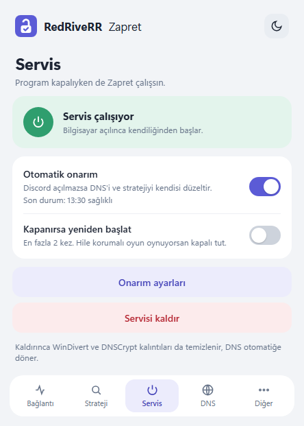
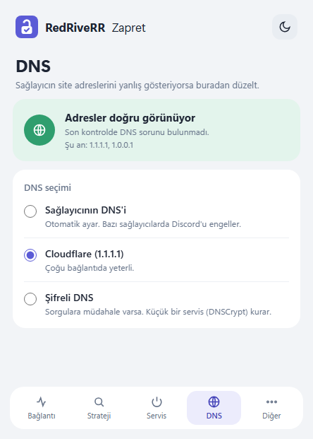
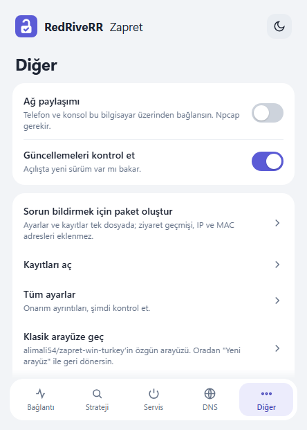

# RedRiveRR Zapret

Türkiye'de **Discord** (ve Roblox) erişimi için [zapret](https://github.com/bol-van/zapret) / Zapret2 kontrol aracı. Sağlayıcınızın DPI (derin paket incelemesi) engelini atlatır, sizin için en uygun yöntemi ölçerek bulur ve bilgisayar açıldığında kendiliğinden çalışır.

Bu depo, [alimali54/zapret-win-turkey](https://github.com/alimali54/zapret-win-turkey) projesinin **RedRiveRR fork'udur** (temel: v4.5). Sürüm 5.0.0 ile adı **RedRiveRR Zapret** oldu; değişikliklerin tamamı [CHANGELOG.md](CHANGELOG.md) dosyasında.

<p>


</p>
<p>



</p>

## İçindekiler
- [Öne çıkanlar](#öne-çıkanlar)
- [İndirme ve kurulum](#i̇ndirme-ve-kurulum)
- [İlk kullanım](#i̇lk-kullanım)
- [Ekranlar](#ekranlar)
- [Servis ve otomatik onarım](#servis-ve-otomatik-onarım)
- [Akıllı analiz nasıl ölçer?](#akıllı-analiz-nasıl-ölçer)
- [Klasik arayüz ve Lite sürüm](#klasik-arayüz-ve-lite-sürüm)
- [Ağdaki cihazlarla paylaşım](#ağdaki-cihazlarla-paylaşım)
- [Sorun giderme](#sorun-giderme)
- [Gizlilik](#gizlilik)
- [Ayarlar dosyası ve komut satırı](#ayarlar-dosyası-ve-komut-satırı)
- [Geliştirme](#geliştirme)
- [Teşekkürler](#teşekkürler)

## Öne çıkanlar
- **Sade, kompakt arayüz** (açık/koyu tema): Bağlantı, Strateji, Servis, DNS ve Diğer ekranları. Durumu tek bakışta gösterir: *Sen → Zapret → Sağlayıcı → Discord*.
- **Akıllı analiz:** stratejiler Discord'un sohbet sunucusuna ve sitelerine gerçek bağlantılarla sınanır, 0–100 arası puanlanır; en iyisi tek tıkla kullanılır.
- **Servis modu:** bilgisayar açılınca Zapret kendiliğinden başlar, programı açık tutmanız gerekmez.
- **Otomatik onarım:** Discord açılmazsa DNS'i, yedek stratejileri ve gerekirse hızlı analizi kendisi dener. Sağlayıcınız engelleme yöntemini değiştirse bile çoğu zaman siz fark etmeden düzelir.
- **DNS koruması:** sağlayıcının DNS'i Discord'u yanlış adrese yönlendiriyorsa tespit eder; Cloudflare'e veya şifreli DNS'e (DNSCrypt) tek tıkla geçer.
- **İki motor:** yeni LUA tabanlı **Zapret2** (önerilen) ve klasik **Zapret**.
- **Güvenli kurulum:** servis kurulurken program Program Files'a taşınabilir (yönetici yetkisiyle çalışan dosyaların başkalarınca değiştirilememesi için).
- **Tanılama paketi ve ayrıntılı log:** sorun bildirmek kolay; ziyaret geçmişi pakete eklenmez.

## İndirme ve kurulum

**Gereksinimler:** Windows 10 veya 11 (64 bit), yönetici yetkisi. Yeni arayüz Microsoft Edge **WebView2** kullanır; Windows 11'de yerleşiktir, Windows 10'da çoğunlukla Windows Update ile gelir. Bulunamazsa program klasik arayüzle açılır.

1. [Releases](https://github.com/RedRiveRR/zapret-win-turkey/releases) sayfasından son sürümü indirin:
   - `RedRiveRR-Zapret-v5.0.0.zip` — tam sürüm (önerilen).
   - `RedRiveRR-Zapret-Lite-v5.0.0.zip` — yalnızca temel işlevler, küçük pencere.
   - `SHA256SUMS.txt` ile indirdiğiniz dosyayı doğrulayabilirsiniz.
2. ZIP'i bir klasöre çıkarın (ör. `Belgeler\RedRiveRR Zapret`). ZIP'in içinden çalıştırmayın.
3. **`RedRiveRR Zapret.exe`** dosyasını çalıştırın; yönetici izni istenir.
4. Servis kurarken program kendisini `C:\Program Files\Zapret Windows Turkiye` klasörüne taşımayı önerir; kabul etmeniz önerilir. Kısayolu bu klasördeki exe'ye göre oluşturun.

> [!NOTE]
> Bazı antivirüsler, paket yakalama sürücüsü (WinDivert/Monkey) içerdiği için zapret dosyalarını yanlışlıkla şüpheli bulabilir. Dosyalar bol-van/zapret dağıtımındaki orijinal ikililerdir; özetleri [THIRD_PARTY.md](THIRD_PARTY.md) dosyasında.

**Eski sürümden geçiş:** 5.0.0'dan önce exe adı `zapret-win-turkey.exe` idi. Yeni sürümü aynı klasöre çıkarırsanız ayarlarınız (`config\`) korunur; eski exe'yi silebilirsiniz. Otomatik onarım görevi ilk açılışta kendiliğinden yeni exe'ye yönlendirilir. Eski kurulumun servisleri başka bir klasördeyse program bunu fark eder ve onayınızla temizler.

## İlk kullanım
1. Programı açın. Açılışta DNS kontrol edilir; sağlayıcınızın DNS'i Discord'u yanlış gösteriyorsa Cloudflare'e geçmeniz önerilir.
2. **Strateji → Hızlı testi başlat.** 1–3 dakikada hazır ve kayıtlı stratejiler ölçülür; sonuç penceresinde **★ Önerileni Kullan**'a basın. Hiçbiri çalışmazsa **Tam analiz** (5–15 dk) sağlayıcıyı baştan tarar.
3. **Bağlantı** ekranındaki güç düğmesiyle başlatın ve Discord uygulamasını **tamamen kapatıp yeniden açarak** deneyin (tarayıcıda denemek yanıltıcıdır).
4. Çalışıyorsa **Servis → Servisi kur**. Otomatik onarımı kabul edin. Artık programı kapatabilirsiniz.

## Ekranlar

| Ekran | Ne yapar |
|---|---|
| **Bağlantı** | Durum (servis çalışıyor, Zapret kapalı, DNS sorunu…), Başlat/Durdur, seçili strateji ve otomatik onarımın son durumu. |
| **Strateji** | Hızlı test / tam analiz, son analizin en iyi üç sonucu, *Tüm sonuçlar*; strateji, motor (Zapret2/klasik) ve site filtresi seçimi. |
| **Servis** | Servis durumu, otomatik onarım ve "kapanırsa yeniden başlat" anahtarları, servisi kurma/kaldırma. |
| **DNS** | Adreslerin doğru gelip gelmediği, etkin DNS; sağlayıcı / Cloudflare (1.1.1.1) / şifreli DNS arasında geçiş. |
| **Diğer** | Ağ paylaşımı, güncelleme kontrolü, tanılama paketi, kayıtlar, tüm ayarlar, klasik arayüz, hakkında. |

**Site filtresi:** *Kapalı* tüm trafiğe uygulanır; *Auto* yalnızca engellendiği anlaşılan sitelere (otomatik liste); *Manuel* `config\hostlist.txt` içindekilere. `config\excludelist.txt` içindeki alan adlarına (varsayılan `com.tr`, `gov.tr`) hiç dokunulmaz.

## Servis ve otomatik onarım
- **Servis** (`ZapretService`) bilgisayar açılınca gecikmesiz başlar. Seçili strateji ve filtre servise yazılır; stratejiyi değiştirmek için servis kuruluyken Strateji ekranından analiz yapmanız yeterlidir, servis yeni stratejiyle kendiliğinden güncellenir.
- **Otomatik onarım** bir zamanlanmış görevdir: oturum açılışında, 30 dakikada bir ve ağ bağlantısı değişince Discord'a bağlanmayı dener. Sorun varsa sırasıyla şunları dener:
  1. DNS düzeltme (zehirlenme varsa Cloudflare),
  2. son analizdeki yedek stratejiler,
  3. gerekirse hızlı akıllı analiz (günde en fazla 2).
  Sonuç Windows bildirimiyle gösterilir. İnternet tamamen kesikse hiçbir şey değiştirilmez; açılışta ağ geç gelirse ~2 dakika beklenir.
- Programı açtığınızda servis çalıştığı halde Discord'a ulaşılamıyorsa onarım önerilir.
- **Kapanırsa yeniden başlat** varsayılan olarak kapalıdır: hile korumalı (anti-cheat) oyunlar zapret'i kapatabilir; tekrar tekrar açılması hesabınız için risk olabilir. Açarsanız en fazla 2 kez yeniden başlatılır.
- **Servisi kaldır / Her şeyi temizle:** servis, onarım görevi, WinDivert/Monkey sürücüleri ve DNSCrypt kaldırılır, DNS otomatiğe (DHCP) döner. İki adımlı onay ister.

## Akıllı analiz nasıl ölçer?
Her strateji winws2 ile kısa süre başlatılır ve `gateway.discord.gg`, `discord.com`, `roblox.com`, Discord CDN'ine TLS 1.2 ve 1.3 ile defalarca bağlanılır. Puan; başarı oranı, gecikme, kararlılık ve sadelikten oluşur. Hedefler `config.ini` → `[SmartAnalysis] Targets=` ile değiştirilebilir.

> [!IMPORTANT]
> Yalnızca **TCP** bağlantıları ölçülür (mesajlaşma, sunucu bağlantısı, sayfalar). Discord **sesli görüşmesi (UDP) ölçülmez**; puan yüksek olsa da sesi ayrıca bir görüşmeyle deneyin.

Zapret motoru hiç başlatılamazsa (ör. sürücü yüklenemiyor) analiz yanıltıcı 0.0 puanlar yerine açık bir hata verir ve önceki sonuçlarınız silinmez.

## Klasik arayüz ve Lite sürüm
- **Klasik arayüz:** *Diğer → Klasik arayüze geç* alimali54/zapret-win-turkey'in özgün penceresini açar (tek sayfa, Windows düğmeleri). Oradaki **Yeni arayüz** düğmesiyle geri dönersiniz. Kalıcı olarak klasik arayüzü kullanmak için *Ayarlar → Yeni arayüz* anahtarını kapatın ya da programı `/eski-arayuz` ile başlatın.
- **Lite sürüm** (`RedRiveRR Zapret Lite.exe`): yalnızca motor klasörüyle gelen küçük paket; başlat/durdur, strateji, servis ve hazır profilleri akıllı test etme (tepsi menüsü). Ağ paylaşımı ve DNSCrypt içermez.

## Ağdaki cihazlarla paylaşım
PlayStation, Xbox, Switch, akıllı TV gibi cihazlar bilgisayarınızdaki Zapret üzerinden bağlanabilir ([go-pcap2socks](https://github.com/DaniilSokolyuk/go-pcap2socks)).

- Bilgisayarda **[Npcap](https://npcap.com/)** kurulu olmalı; bilgisayar ve cihaz aynı yerel ağda olmalı; Zapret çalışıyor olmalı.
- *Diğer → Ağ paylaşımı* anahtarını açın, güvenlik duvarı iznini onaylayın.
- Diğer cihazın ağ ayarlarını elle girin:
  - **IP adresi:** `172.24.2.10` – `172.24.2.255` arasında kullanılmayan bir adres (ör. `172.24.2.50`)
  - **Alt ağ maskesi:** `255.255.0.0`
  - **Ağ geçidi:** `172.24.2.1`
  - **DNS:** `1.1.1.1` ve `8.8.8.8`

> [!CAUTION]
> Wi-Fi üzerinden paylaşımda belirgin hız düşüşü olabilir; bilgisayarı modeme kabloyla bağlamanız önerilir. Paylaşım sürerken bilgisayar açık kalmalıdır.

## Sorun giderme

| Belirti | Ne yapmalı |
|---|---|
| Discord bağlanmıyor ama "yol açık" görünüyor | Sağlayıcınız engelleme yöntemini değiştirmiş olabilir: **Strateji → Hızlı test**. Servis kuruluysa analiz servisi kendisi günceller. Discord'u tepsiden tamamen kapatıp yeniden açın. |
| Analizde bütün stratejiler 0.0 | Önce internetinizin çalıştığından emin olun. "Zapret motoru başlatılamadı" uyarısı çıkarsa programı kapatıp açın, sürmezse bilgisayarı yeniden başlatın. |
| "DNS sorunu" | **DNS → Cloudflare'e geç.** Sağlayıcı 53. porta müdahale ediyorsa **Şifreli DNS** kullanın. |
| "Servis durdu" | Bir program (çoğunlukla oyun hile koruması) zapret'i kapatmış olabilir. Bilgisayarı yeniden başlatın ya da **Servis → Servisi kaldır**, ardından **Servisi kur**. |
| Yeni arayüz açılmıyor | WebView2 eksik olabilir; program klasik arayüzle açılır. [WebView2 çalışma zamanını](https://developer.microsoft.com/microsoft-edge/webview2/) kurabilirsiniz. |
| Sesli görüşme çalışmıyor | Puan sesi ölçmez; *Tüm sonuçlar*dan başka bir stratejiyi *Seçileni Kullan* ile deneyin. |
| GoodbyeDPI / başka zapret çalışıyor | Program açılışta çakışan araçları (GoodbyeDPI, ByeDPI, başka klasördeki winws) tespit eder ve onayınızla kapatır. |

Sorun sürerse **Diğer → Sorun bildirmek için paket oluştur** ile masaüstüne bir ZIP kaydedin ve [Issues](https://github.com/RedRiveRR/zapret-win-turkey/issues) sayfasına ekleyin. Kayıtlar `logs\app.log` dosyasındadır.

## Gizlilik
- Program hiçbir veriyi bir sunucuya göndermez. Tek dış sorgu, açılıştaki **güncelleme kontrolüdür** (GitHub API; `[Settings] UpdateCheck=0` ile kapatılır). Hiçbir şey otomatik indirilmez.
- `config\autohostlist.txt` *Auto* filtrede engellendiği anlaşılan siteleri tutar; yalnızca bilgisayarınızda kalır.
- Tanılama paketine ziyaret ettiğiniz siteler, IP ve MAC adresleri **eklenmez**.

## Ayarlar dosyası ve komut satırı
Ayarlar `config\config.ini` içindedir; çoğu arayüzden değiştirilir.

| Bölüm | Anahtar | Anlamı |
|---|---|---|
| `[Settings]` | `ActiveEngine`, `ActiveStrategy`, `FilterMode` | Motor (0 = Zapret2), strateji, filtre (0 kapalı, 1 auto, 2 manuel) |
| `[Settings]` | `UpdateCheck` | Açılışta sürüm kontrolü (1/0) |
| `[Health]` | `Enabled`, `AutoFixDns`, `AutoAnalyze` | Otomatik onarım ve adımları |
| `[Service]` | `AutoRestart` | Servis kapanırsa yeniden başlat (0/1) |
| `[SmartAnalysis]` | `Targets` | Ölçüm hedefleri (`host:ağırlık,…`) |
| `[Arayuz]` | `Yeni`, `Tema` | Yeni arayüz (1/0), tema (`acik`/`koyu`) |

Komut satırı: `/eski-arayuz` (klasik pencere), `/yeni-arayuz`, `/saglik` (otomatik onarım görevinin kullandığı tek seferlik kontrol).

## Geliştirme
AutoIt3 uygulaması. Ortak mantık `lib/` altında (GUI'den bağımsız, birim testli), pencereler `ui/` altında; yeni arayüz `ui/web/` (HTML/CSS/JS, WebView2 ile `ui/WebView2.au3`).

```powershell
pwsh -NoProfile -File scripts\check.ps1   # Au3Check + sürüm tutarlılığı + birim testleri
pwsh -NoProfile -File scripts\build.ps1   # paket: upstream ikilileri (SHA256 sabit) + derlenen exe + WebView2Loader
pwsh -NoProfile -File scripts\make-icon.ps1  # kilit logosundan ui\simge\kilit.ico
```

AutoIt'in ASCII karakterli bir yolda olması gerekir (Au3Check Türkçe karakterli yollarda hatalı sonuç verir). Ayrıntılar: [CONTRIBUTING.md](CONTRIBUTING.md). Her push'ta GitHub Actions aynı denetimleri çalıştırır ve test paketi üretir.

## Teşekkürler
- **alimali54** — bu fork'un temeli [zapret-win-turkey](https://github.com/alimali54/zapret-win-turkey).
- [@bol-van](https://github.com/bol-van) — **zapret** motoru ve [zapret-win-bundle](https://github.com/bol-van/zapret-win-bundle).
- [@cagritaskn](https://github.com/cagritaskn) — otomatik blockcheck fikri ([splitwire-turkey](https://github.com/cagritaskn/splitwire-turkey)).
- [@DaniilSokolyuk](https://github.com/DaniilSokolyuk) — [go-pcap2socks](https://github.com/DaniilSokolyuk/go-pcap2socks).
- [@jedisct1](https://github.com/jedisct1) — [dnscrypt-proxy](https://github.com/dnscrypt/dnscrypt-proxy).

Üçüncü taraf bileşenler ve lisansları: [THIRD_PARTY.md](THIRD_PARTY.md).
