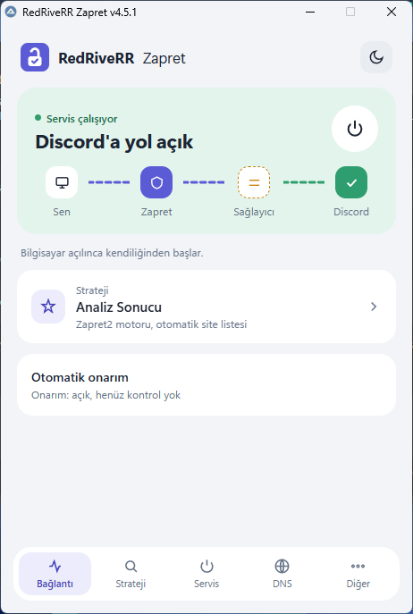
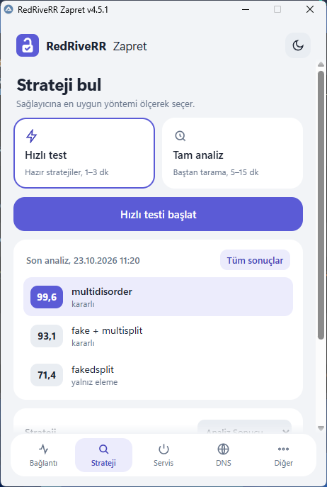
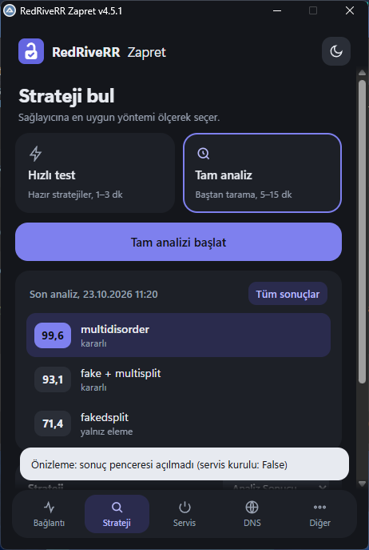

# RedRiveRR Zapret

Türkiye'de Discord (ve Roblox) erişimi için [zapret](https://github.com/bol-van/zapret) / Zapret2 kontrol aracı. Bu depo, [alimali54/zapret-win-turkey](https://github.com/alimali54/zapret-win-turkey) projesinin **RedRiveRR fork'udur**; değişikliklerin tamamı [CHANGELOG.md](CHANGELOG.md) dosyasında.

**Bu fork'ta öne çıkanlar**
- Yeni, sade arayüz (açık/koyu tema): Bağlantı, Strateji, Servis, DNS ve Diğer ekranları.
- Akıllı analiz: stratejiler Discord'a gerçek bağlantılarla ölçülüp puanlanır; en iyisi tek tıkla kullanılır.
- Servis modu ve otomatik onarım: bilgisayar açılınca çalışır; Discord açılmazsa DNS'i ve stratejiyi kendisi düzeltmeyi dener.
- Program Files'a kurulum, tanılama paketi, ayrıntılı log.

**Gereksinim:** Windows 10/11 (64 bit), yönetici yetkisi. Yeni arayüz Microsoft Edge WebView2 kullanır (Windows 11'de yerleşik); bulunamazsa program klasik arayüzle açılır.

---

## Temel proje açıklaması (upstream)

# Zapret Windows Türkiye / (Zapret2)

Bu programın amacı, Türk kullanıcılar için DPI (Deep Packet Inspection / Derin Paket İncelemesi) tabanlı internet sansürlerini ve kısıtlamalarını atlatmak amacıyla geliştirilmiş olan [zapret-win-bundle](https://github.com/bol-van/zapret-win-bundle) projesinin kullanımını kolaylaştırmaktır.

## Programın Özellikleri

- **DNS Kontrolü:** ISS tarafından DNS'inize müdahale ediliyorsa tespiti yapılır. DNS'i sağlama almak için YogaDNS kurmanızı ve Google DoH ayarlamanızı öneririm.
- **Dnscrypt-proxy servisi:** YogaDNS kullanmanızı daha çok tavsiye etsem de Dnscrypt-proxy kullanarak da şifreli DNS servisi kullanabilirsiniz. Her şey tek programda olsun diyenler tercih edebilir. 
- **Blockcheck:** ISS'niz için çalışan stratejiyi bulmak için blockcheck yapabilirsiniz.
- **Hazır Stratejiler:** Bulabildiğim bazı hazır stratejileri programa ekledim, blockcheck yapmaya gerek kalmadan deneyebilirsiniz.
- **Çoklu Motor Desteği (Multi-Engine):** Hem eski klasik Zapret motorunu hem de yeni nesil LUA tabanlı gelişmiş Zapret2 motorunu entegre olarak barındırır.
- **Manuel Kullanım:** "Zapret'i Başlat" seçeneği ile program içinden anlık kullanım sağlar. Program kapatıldığında tüm süreçler temizlenir.
- **Servis Desteği:** "Servis Olarak Yükle" butonu ile Windows Servisi olarak kurma imkanı sunar. Bilgisayar her açıldığında otomatik başlar. Bu programın açılmasına gerek kalmaz.
- **Hostlist Desteği:** Sadece sansürlü siteleri listeye ekleyerek (otomatik veya manuel) filtreleme yapar; normal internet trafiğinizi kesinlikle yormaz.
- **Excludelist Desteği:** Zapret'in aktif olmasını istemediğiniz domain'leri excludelist.txt dosyasına yazabilirsiniz. Varsayılan olarak com.tr ve gov.tr uzantılı siteler eklenmiştir.
- **Ağdaki Cihazlarla Paylaş:** `go-pcap2socks` entegrasyonu sayesinde, bilgisayarınızda çalışan Zapret motorunu yerel ağdaki diğer cihazlarınızla (PlayStation, Xbox, Nintendo Switch, Akıllı TV vb.) paylaşmanızı sağlar. Konsollarda Discord ve Roblox gibi erişim engellerini aşmanın en kararlı yoludur.

## Yerel Ağ Paylaşımı (Konsol / Diğer Cihazlar)

**Ağdaki Cihazlarla Paylaş** özelliği, bilgisayarınızda çalışan Zapret yapılandırmasını PlayStation, Xbox ve Roblox gibi hizmetleri kullanan diğer cihazlarda kullanmanızı sağlar. Özellik iki farklı yöntem sunar: **go-pcap2socks** ve **V2Ray + MaraDNS**.

Yöntem seçimi, bilgisayarın ağa nasıl bağlandığına ve hangi uygulamaların kullanılacağına göre değişebilir.

> [!CAUTION]
> Wi-Fi üzerinden paylaşım yapıldığında özellikle go-pcap2socks yönteminde belirgin hız düşüşü yaşanabilir. Performans sorunu yaşıyorsanız bilgisayarı modem/router'a Ethernet kablosuyla bağlamanız önerilir.

### Yöntem 1: go-pcap2socks

Bu yöntem, ağdaki cihazların trafiğini go-pcap2socks aracılığıyla bilgisayar üzerinden aktarır.

#### Gereksinimler ve kurulum

- Bilgisayarda **[Npcap](https://npcap.com/)** sürücüsünün kurulu olması gerekir.
- Bilgisayar ve paylaşım yapılacak cihaz aynı yerel ağa bağlı olmalıdır.
- Program içerisinden **Ağdaki Cihazlarla Paylaş** özelliğini açıp go-pcap2socks yöntemini seçin.
- Gerekli izinleri onaylayın ve paylaşımın başlamasını bekleyin.

Paylaşım için ağdaki diğer cihazın ağ ayarlarını manuel olarak yapılandırın:

- **IP Adresi:** `172.24.2.10` ile `172.24.2.255` arasında kullanılmayan bir adres. Örnek: `172.24.2.50`
- **Alt Ağ Maskesi:** `255.255.0.0`
- **Varsayılan Ağ Geçidi:** `172.24.2.1`
- **Birincil DNS:** `1.1.1.1`
- **İkincil DNS:** `8.8.8.8`

Bu IP ayarları go-pcap2socks yöntemine aittir. Aynı IP adresini başka bir cihazda kullanmayın.

#### Avantajları

- Discord gibi ek uygulamaları oyunla birlikte kullanmak isteyenler için uygun bir seçenektir.
- NAT ve trafik aktarımı uyumluluğu açısından V2Ray + MaraDNS yöntemine göre avantaj sağlayabilir.
- Ağ trafiğinin daha kapsamlı aktarılmasının gerektiği durumlarda tercih edilebilir.

#### Dezavantajları

- **Npcap** kurulumu gerektirir.
- Wi-Fi üzerinden kullanıldığında belirgin hız kaybı yaşanabilir.

### Yöntem 2: V2Ray + MaraDNS

Bu yöntem, V2Ray ve MaraDNS bileşenlerini kullanarak DNS yönlendirmesi üzerinden çalışır. Gerekli yapılandırma program tarafından gerçekleştirilir.

#### Kurulum ve yapılandırma

1. Program içerisinden **Ağdaki Cihazlarla Paylaş** özelliğini açıp V2Ray + MaraDNS yöntemini seçin.
2. Gerekli bileşenlerin başlatılmasını bekleyin.
3. Windows Güvenlik Duvarı izin isteği gösterirse gerekli izni onaylayın.
4. Programın gösterdiği mesaj kutusundaki IP adresini not alın.
5. Ağdaki diğer cihazın DNS ayarlarında, programın gösterdiği IP adresini kullanın.

#### Avantajları

- **Npcap gerektirmez.**
- Wi-Fi üzerinden kullanım için pratik bir alternatiftir.
- Yalnızca belirli bir oyunu veya hizmeti kullanıp işiniz bittiğinde paylaşımı kapatmak istiyorsanız uygundur.
- Ağ yapılandırmasını elle düzenleme ihtiyacını azaltır.

#### Dezavantajları

- Bazı uygulamalar ve çevrim içi hizmetler düzgün çalışmayabilir.
- NAT davranışı olumsuz etkilenebilir. Bu durum çevrim içi oyunlarda bağlantı veya eşleştirme sorunlarına neden olabilir.

### Hangi yöntemi seçmeliyim?

**Senaryo 1 — Oyun oynarken Discord da kullanmak istiyorum.**

Bilgisayarınızı Ethernet kablosuyla modem/router'a bağlayabiliyorsanız **go-pcap2socks** yöntemini tercih edin. Oyun ve Discord gibi ek uygulamaları birlikte kullanmak için daha uygun bir seçenek olabilir.

**Senaryo 2 — Yalnızca Roblox oynayacağım, işim bitince paylaşımı kapatacağım ve bilgisayarımı Wi-Fi üzerinden kullanıyorum.**

Bu durumda **V2Ray + MaraDNS** yöntemini tercih edebilirsiniz. Npcap gerektirmez ve Wi-Fi üzerinden kullanım için pratik bir alternatiftir.

### Yöntemlerin karşılaştırması

| Özellik | go-pcap2socks | V2Ray + MaraDNS |
|---|---|---|
| Npcap gereksinimi | Gerekli | Gerekli değil |
| Wi-Fi performansı | Hız düşüşü yaşanabilir | Hız düşüşü beklenmez |
| Discord ve oyun birlikte | Tercih edilebilir | Bazı hizmetlerde sorun yaşanabilir |
| NAT uyumluluğu | NAT sorunu beklenmez | NAT sorunları yaşanabilir |
| Ek yapılandırma | Manuel IP ve DNS girişi | Manuel DNS girişi |

**Not:** Her iki yöntemde de paylaşım bilgisayar üzerinden yapıldığı için bilgisayar açık kalmalıdır. Performans ve uyumluluk, ağ yapılandırmasına ve kullanılan hizmetlere göre değişebilir.

## Çakışma Önleme

Program, arka planda çalışabilecek diğer DPI atlatma araçlarıyla (`GoodbyeDPI` vb.) veya eski `WinDivert` sürücü kalıntılarıyla çakışmaları otomatik olarak tespit eder, temizler ve güvenli bir açılış sağlar.

## Teşekkürler

- **Zapret** projesinin ana motoru için [@bol-van](https://github.com/bol-van)'a,
- Otomatik blockcheck mantığı ve ilhamı için [splitwire-turkey](https://github.com/cagritaskn/splitwire-turkey) geliştiricisi [@cagritaskn](https://github.com/cagritaskn)'a,
- [go-pcap2socks](https://github.com/DaniilSokolyuk/go-pcap2socks) projesinin geliştiricisi [@DaniilSokolyuk](https://github.com/DaniilSokolyuk)'a,
- [dnscrypt-proxy](https://github.com/dnscrypt/dnscrypt-proxy) projesinin geliştiricisi [@jedisct1](https://github.com/jedisct1)'e,
- [V2Ray + MaraDNS yöntemi](https://ntc.party/t/%D0%BE%D0%B1%D1%85%D0%BE%D0%B4-%D0%B1%D0%BB%D0%BE%D0%BA%D0%B8%D1%80%D0%BE%D0%B2%D0%BA%D0%B8-youtube-%D0%B4%D0%BB%D1%8F-%D0%BB%D1%8E%D0%B1%D1%8B%D1%85-smart-tv-%D1%81-goodbyedpi-v2ray-maradns/9415) için [@valdikss](https://github.com/valdikss)'e teşekkürler.
