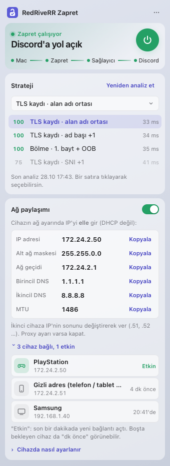
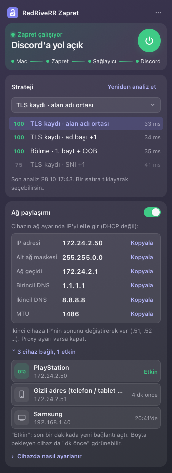

# RedRiveRR Zapret — macOS

Türkiye'de Discord'u (ve Roblox'u) macOS'ta açar. Menü çubuğunda yaşar: kilit simgesine tıklayınca küçük bir panel açılır.

<p>


</p>

## Gereksinimler
- macOS 12 Monterey veya sonrası.
- **Intel ve Apple Silicon (M1, M2, M3, M4…)** Mac'ler: paketteki tüm programlar her iki işlemci için yerleşik (universal), Rosetta gerekmez.
- Bir kez yönetici parolası (sistem proxy ayarı ve ağ paylaşımı için küçük bir yardımcı kurulur).

## Kurulum
1. [Sürümler](https://github.com/RedRiveRR/zapret-win-turkey/releases/latest) sayfasından `RedRiveRR-Zapret-macOS-….zip` dosyasını indirin ve açın.
2. **RedRiveRR Zapret.app**'i açın. Uygulama Apple'a ücretli geliştirici hesabıyla imzalatılmadığı için macOS ilk açılışta uyarır:
   - **macOS 12–14:** uygulamaya **sağ tıklayın → Aç → Aç**.
   - **macOS 15 Sequoia ve sonrası:** çift tıklayın, uyarıyı kapatın; **Sistem Ayarları → Gizlilik ve Güvenlik** sayfasının altındaki **Yine de Aç** düğmesine basın.
   - Hiçbir uyarı çıkmadan açılmıyorsa ("-47" hatası ya da hiçbir şey olmaması): Terminal'de `xattr -cr ` yazın (sonunda bir boşluk), uygulamayı Terminal penceresine sürükleyip bırakın, Enter'a basın ve yeniden açın.
3. "Uygulamalar klasörüne taşınsın mı?" → **Taşı**.
4. Menü çubuğunda kilit simgesi belirir, panel kendiliğinden açılır.

## İlk kullanım
1. Paneldeki **güç düğmesine** basın. İlk seferde macOS yönetici parolası ister (yardımcı kurulur).
   - **macOS 13 ve sonrası:** "Arka plan öğesi eklendi" bildirimi çıkabilir; bu yardımcıdır. **Sistem Ayarları → Genel → Giriş Öğeleri → Arka planda izin ver** altında RedRiveRR Zapret **açık** kalmalı.
2. Durum "Discord'a yol açık" olunca Discord'u açın. Discord zaten açıksa panelde çıkan **Discord'u yeniden başlat** düğmesine basın (önceden açık Discord eski bağlantısını tutar).
3. Discord açılmazsa: **Strateji → Analiz et**. Uygulama sağlayıcınızda çalışan yöntemi yaklaşık 20 saniyede ölçer, en iyisini seçer ve uygular. Sonuçlardan birine tıklayarak elle de seçebilirsiniz.

Kilit simgesi durumu gösterir: **açık kilit** Zapret çalışıyor, **kapalı kilit** durdu. Sağ tık: Paneli aç / Zapret'ten çık. Uygulamadan çıkınca Mac'in proxy ayarları eski hâline döner.

## Nasıl çalışır
- Sağlayıcı iki yerden engelliyor: **DNS** (Discord adlarını engel sayfasına yönlendirir) ve **DPI** (bağlantının ilk paketindeki site adını görüp keser).
- Uygulama Discord/Roblox adlarını **şifreli DNS (DoH)** ile çözer (Mac'in DNS ayarı değişmez) ve bağlantının ilk paketini [zapret](https://github.com/bol-van/zapret)'in `tpws` aracıyla bölerek DPI'nin site adını görmesini engeller.
- Yalnız Discord ve Roblox adresleri bu yoldan geçer; diğer siteler olduğu gibi çalışır.
- Ayrıntı: Discord'un güncelleyicisi sistem proxy ayarını her zaman okumadığından uygulama Başlat'ta `HTTPS_PROXY` oturum değişkenini de ayarlar, durunca kaldırır.

## Ağ paylaşımı (PS5, PS4, Xbox, Switch, TV)
Konsol ve TV, bu Mac üzerinden Discord'a bağlanabilir (Windows sürümüyle aynı yöntem, [go-pcap2socks](https://github.com/DaniilSokolyuk/go-pcap2socks)).
1. Zapret'i başlatın, panelde **Ağ paylaşımı**'nı açın.
2. Cihazın ağ ayarında IP'yi **elle (Manuel)** girin — değerler panelde, her satırda Kopyala var:
   - IP adresi `172.24.2.50` (ikinci cihaz `.51`, `.52` …), alt ağ maskesi `255.255.0.0`, ağ geçidi `172.24.2.1`
   - Birincil DNS `1.1.1.1`, ikincil DNS `8.8.8.8`, MTU paneldeki değer (ör. `1486`); proxy **kullanma**.
   - Cihaz menülerinin yolu panelde "Cihazda nasıl ayarlanır" altında.
3. Bağlı cihazlar panelde listelenir (PlayStation, Samsung … — türü ağ adresinin üretici kodundan bulunur; adresin kendisi gösterilmez).

Notlar: Mac açık, Zapret çalışıyor ve paylaşım açık olmalı; yoksa cihaz internete çıkamaz. Bilgisayarsız oynarken cihazda IP'yi **Otomatik**'e döndürün. Kablo Wi-Fi'den hızlı ve kararlıdır. macOS 15+ "yerel ağ erişimi" izni sorarsa **İzin ver** deyin.

## Güncelleme
Uygulama açılışta yeni sürüm olup olmadığına bakar; varsa panelin üstünde **Güncelle** çıkar. İndirilen paket, sürümdeki `SHA256SUMS.txt` özetiyle, uygulama kimliği ve imzasıyla doğrulandıktan sonra kurulur ve uygulama yeniden açılır.

## Sorun giderme
- **Discord "Checking for updates" / "Update failed"de kalıyor:** panelden **Discord'u yeniden başlat**.
- **"Yönetici yardımcısı çalışmıyor":** Giriş Öğeleri → Arka planda izin ver altında RedRiveRR Zapret'i açın, sonra yeniden Başlat.
- **Hiçbir yöntem çalışmıyor:** Strateji → Analiz et; panel menüsü (⋯) → **Analiz raporunu aç** ayrıntıyı gösterir.
- **Kayıtlar:** panel menüsü → **Kayıtları aç** (`~/Library/Logs/RedRiveRR Zapret`). Ziyaret geçmişi yazılmaz; yalnız Discord/Roblox bağlantıları ve hatalar.
- **Sesli sohbet:** ses UDP ile gider ve bu yoldan geçmez; Türkiye'de ses şu an engelli değil.

## Kaldırma
1. Panel menüsü → **Zapret'ten çık** (proxy ayarları geri alınır).
2. Uygulamayı Çöp Sepeti'ne taşıyın.
3. Yardımcıyı da kaldırmak için Terminal'de:
   ```bash
   sudo launchctl bootout system/com.redriverr.zapret.helper
   sudo rm -f /Library/LaunchDaemons/com.redriverr.zapret.helper.plist /Library/PrivilegedHelperTools/com.redriverr.zapret.helper /Library/PrivilegedHelperTools/com.redriverr.zapret.pcap2socks
   sudo rm -rf "/Library/Application Support/RedRiveRR Zapret"
   rm -rf ~/Library/"Application Support/RedRiveRR Zapret" ~/Library/Logs/"RedRiveRR Zapret"
   ```

## Geliştirme
`macos/` (SwiftPM, Swift 5.7+, macOS 12+): `swift build && swift test`, paket `bash macos/scripts/build-app.sh` (Go gerekir: go-pcap2socks kaynaktan universal derlenir). Sürüme ekleme `macos/scripts/release-mac.sh <etiket>` (önce deneme; `--yayinla` ile yükler).
